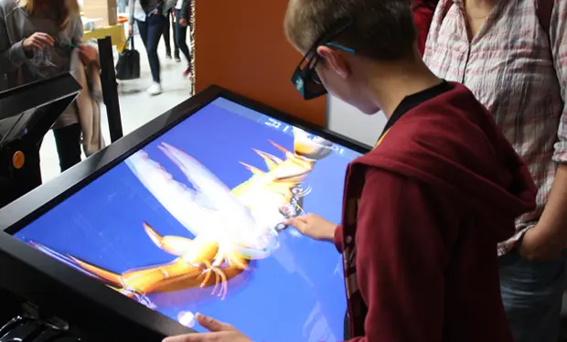

## Overview
This project mainly covered work with a touch table and 3D vision. The first applications were designed for attractions in France. The main one being an aquarium, Oceanopolis. As time went by more applications were bundled into packages, allowing any to be dynamically loaded.

## Technology
Most of the applications were made in Unity3D and some of the simpler ones were completed in Adobe's AirSDK. The touch tables were mainly windows but ports were made to iOS for iPads and some glasses-free 3D vision android tablets. In the early days of Unity,  video textures weren't supported for iOS so I did add a native plugin to do so with OpenGL+AVPlayer.

## Fun fact
One of the applications was built around medical scans of animals, mainly marine life. One I really enjoyed looking at was a sea urchin scan. I know the team also scanned a mouse, sea turtle, and more.

*Photo Credit: [Espace des siences](https://espace-sciences.org/espace-numerique/projet/flaque-3d) / © Espace des siences*